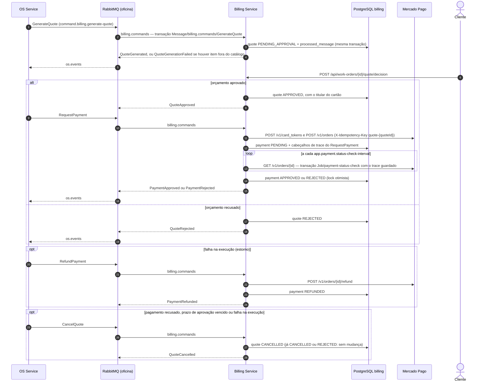
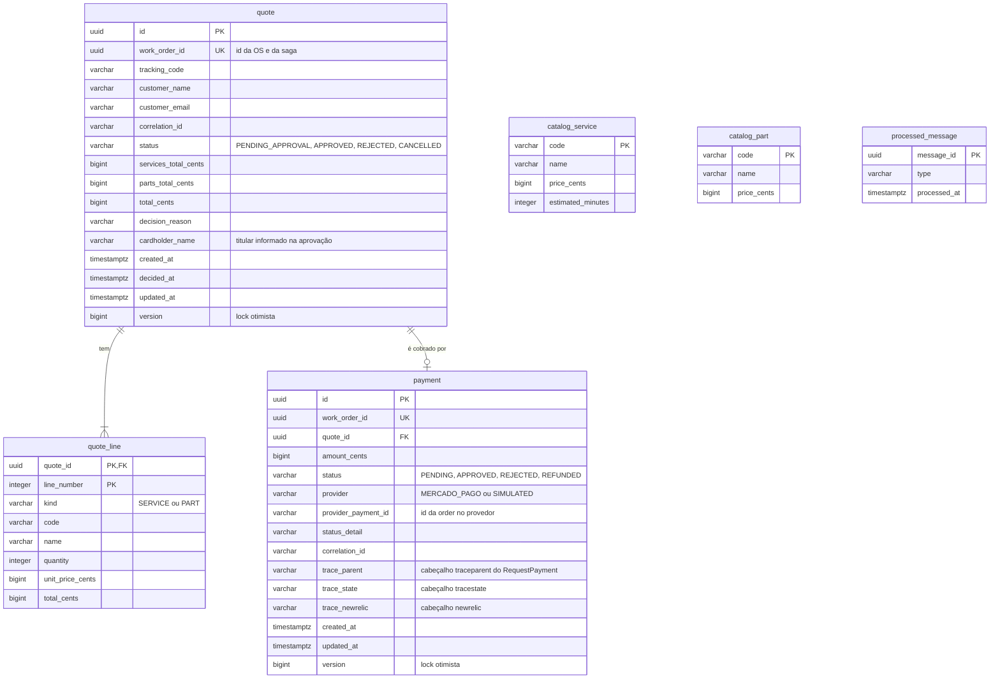

# Arquitetura do Billing Service

Visão do serviço em três diagramas: componentes por camada, participação na saga e modelo de
dados. O contexto geral (papel no sistema, mensagens, configuração) está no [README](../README.md).

## Componentes por camada

As setas cheias são chamadas; as tracejadas ligam um adaptador à porta que ele implementa. O domínio
não depende de framework: aplicação e infraestrutura dependem dele, nunca o contrário.

```mermaid
flowchart TB
    cliente(["Cliente ou atendente<br/>HTTP com JWT"])
    os(["OS Service<br/>orquestrador da saga"])

    subgraph presentation["Apresentação (presentation)"]
        catalogController["CatalogController<br/>/api/catalog/*"]
        workOrderController["WorkOrderBillingController<br/>/api/work-orders/{id}/quote, /payment"]
        infoController["InfoController<br/>/api/info"]
        errorHandler["RestExceptionHandler"]
    end

    subgraph application["Aplicação (application)"]
        catalogQuery["CatalogQueryService"]
        quoteService["QuoteApplicationService<br/>generate, decide, cancel"]
        paymentService["PaymentApplicationService<br/>requestPayment, refund"]
        statusCheck["PaymentStatusCheckService<br/>checkPending"]
        eventPort[["EventPublisher"]]
        tracingPort[["Tracing"]]
    end

    subgraph domain["Domínio (domain)"]
        quote["Quote, QuoteLine, QuotePricing"]
        payment["Payment, TraceContext"]
        catalog["CatalogService, CatalogPart"]
        repoPorts[["QuoteRepository<br/>PaymentRepository<br/>CatalogRepository"]]
        gatewayPort[["PaymentGateway"]]
    end

    subgraph infrastructure["Infraestrutura e adaptadores (infrastructure)"]
        web["CorrelationIdFilter<br/>SecurityConfiguration + JwtConfiguration"]
        listener["BillingCommandListener<br/>billing.commands"]
        handlers["GenerateQuote, RequestPayment,<br/>CancelQuote, RefundPayment handlers"]
        idempotency["IdempotentMessageProcessor<br/>processed_message"]
        codec["EnvelopeCodec"]
        publisher["RabbitEventPublisher<br/>publicação depois do commit"]
        topology["RabbitTopologyConfiguration"]
        scheduler["PaymentStatusScheduler<br/>@Scheduled"]
        jpa["Adaptadores JPA<br/>(RepositoryAdapters)"]
        mercadoPago["MercadoPagoPaymentGateway"]
        simulated["SimulatedPaymentGateway"]
        newRelic["NewRelicTracing<br/>@Trace(dispatcher = true)"]
    end

    postgres[("PostgreSQL billing")]
    rabbit[("RabbitMQ<br/>exchange oficina")]
    mpApi[("Mercado Pago<br/>API de Orders")]
    nrAgent[("Agente Java do New Relic")]

    cliente --> web --> workOrderController
    web --> catalogController
    web --> infoController
    catalogController --> catalogQuery
    workOrderController --> quoteService
    workOrderController --> paymentService

    os -->|"comandos"| rabbit
    rabbit -->|"billing.commands"| listener
    listener --> codec
    listener --> tracingPort
    listener --> idempotency --> handlers
    handlers --> quoteService
    handlers --> paymentService
    scheduler --> statusCheck
    statusCheck --> tracingPort

    catalogQuery --> repoPorts
    quoteService --> quote
    quoteService --> repoPorts
    quoteService --> eventPort
    paymentService --> payment
    paymentService --> repoPorts
    paymentService --> gatewayPort
    paymentService --> eventPort
    statusCheck --> payment
    statusCheck --> gatewayPort
    statusCheck --> eventPort
    quote --> catalog

    jpa -.-> repoPorts
    mercadoPago -.-> gatewayPort
    simulated -.-> gatewayPort
    publisher -.-> eventPort
    newRelic -.-> tracingPort

    jpa --> postgres
    idempotency --> postgres
    mercadoPago --> mpApi
    publisher --> codec
    publisher -->|"event.billing.*"| rabbit
    topology --> rabbit
    newRelic --> nrAgent
    rabbit -->|"os.events"| os
```

O adaptador de pagamento é escolhido por `APP_PAYMENT_GATEWAY` (`mercadopago` no kind,
`simulated` fora do cluster e nos testes).

## Participação na saga

O OS Service orquestra; o Billing responde a comandos com eventos e não conhece os outros
participantes. O diagrama mostra o caminho com aprovação e pagamento pelo Mercado Pago, a recusa
do orçamento e as compensações que o orquestrador pode pedir.

Com o adaptador simulado, `APRO` aprova já na criação e o `PaymentApproved` sai no processamento
do `RequestPayment`; no Mercado Pago a criação volta pendente e quem publica o resultado é a
verificação periódica. Toda publicação acontece depois do commit da transação do banco.

## Modelo de dados

Esquema do Flyway (`V1__init.sql`, `V2__quote_cardholder_name.sql`, `V3__payment_trace_context.sql`).
As linhas do orçamento guardam código, nome e preço do catálogo no momento do orçamento, sem chave
estrangeira para o catálogo.

